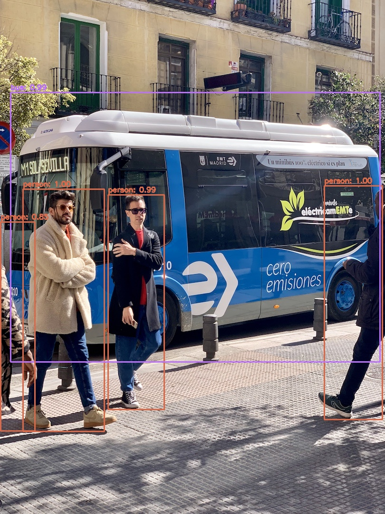
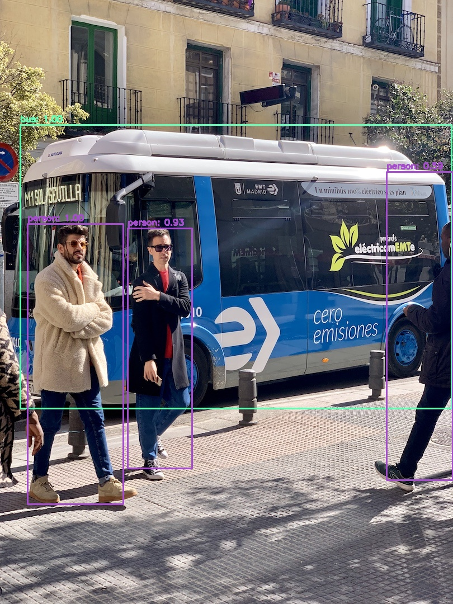
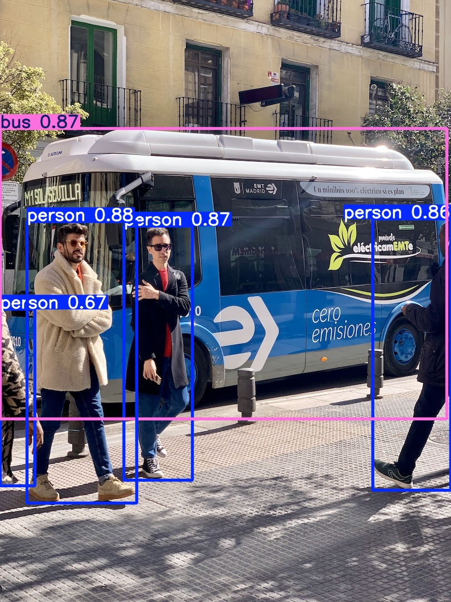
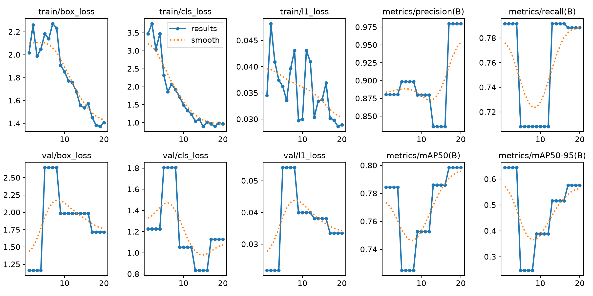
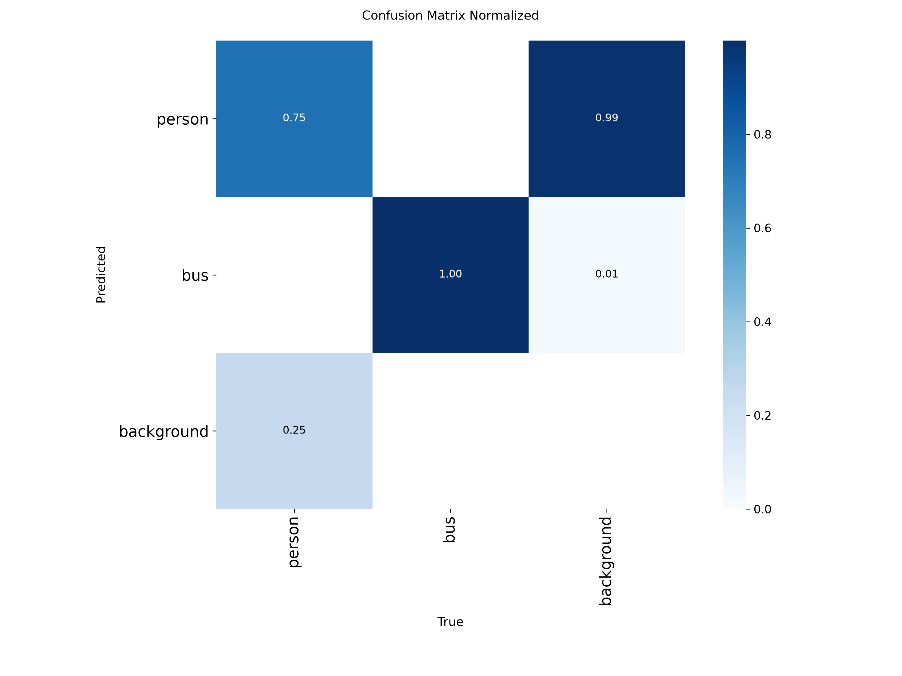
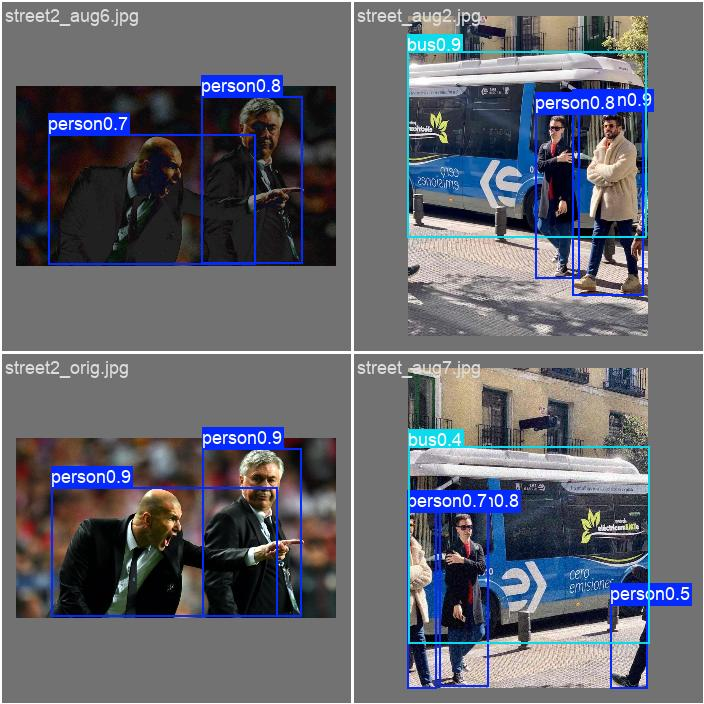
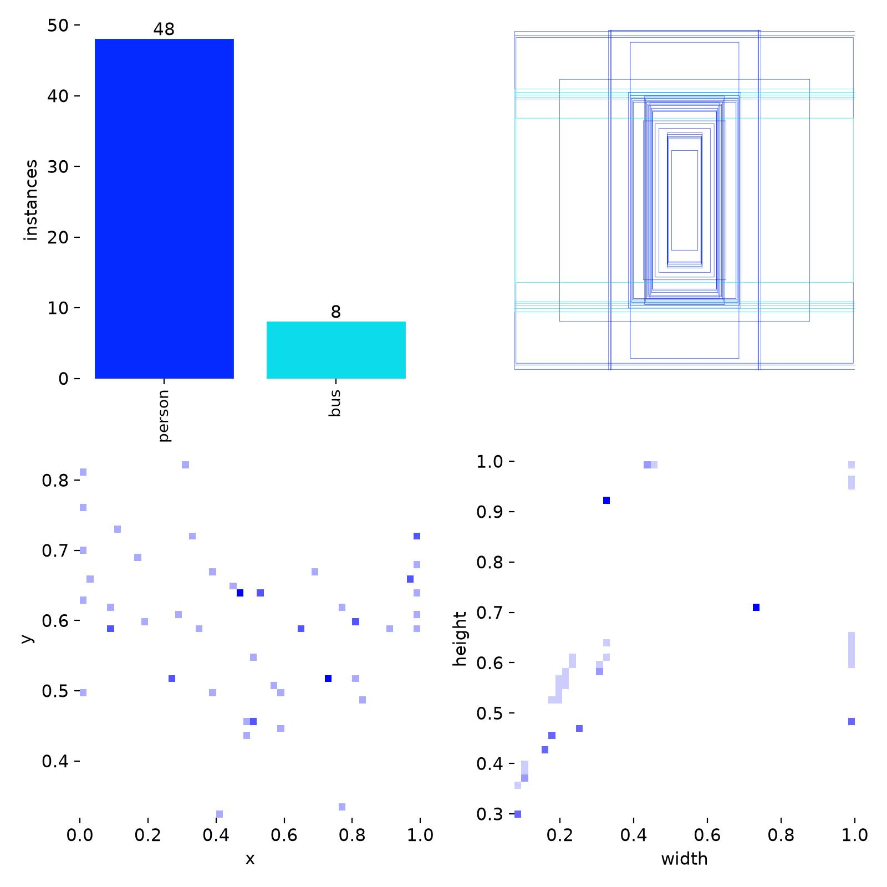

# 实验4：目标检测案例练习

> 计算机视觉课程实验 —— 基于 OpenCV DNN（YOLOv3 / MobileNet-SSD）与 YOLO26n 的目标检测实践
>
> 全部代码均在本机实际运行通过，报告中的指标与结果图均为真实产物。

**关键词**：目标检测 · OpenCV DNN · YOLOv3 · SSD · YOLO26n · 迁移学习 · 数据增强

**作者**：`[填写姓名]`　|　**学号**：`[填写学号]`　|　**课程**：计算机视觉

---

## 一、实验概览

| 模块 | 任务 | 使用技术 | 状态 |
| :--- | :--- | :--- | :---: |
| **内容1** | 用 OpenCV DNN 分别加载 YOLOv3 与 SSD 完成目标检测，并改为调用摄像头实时检测 | `cv2.dnn` / Darknet / Caffe | ✅ |
| **内容2 - 任务1** | 使用 YOLO26n 跑通推理流程 | `ultralytics` 源码库 | ✅ |
| **内容2 - 任务2** | 扩大数据集规模，并在个人数据集上训练 YOLO26n | 伪标注 + 数据增强 + 迁移学习 | ✅ |

---

## 二、仓库结构

```
实验四/
├── README.md                        # 本文件
├── requirements.txt                 # 依赖清单
│
├── part1_opencv_dnn/                # 内容1：OpenCV DNN 目标检测
│   ├── download_models.py           #   一键下载模型权重（权重不随仓库提交）
│   ├── yolov3_detection.py          #   YOLOv3 图片检测 + 摄像头实时检测
│   ├── ssd_detection.py             #   MobileNet-SSD 图片检测 + 摄像头实时检测
│   ├── models/                      #   配置文件（权重需下载）
│   │   ├── yolov3.cfg / coco.names
│   │   ├── deploy.prototxt / voc.names
│   │   └── yolov3.weights, *.caffemodel   ← 由 download_models.py 下载
│   └── results/                     #   检测结果图
│       ├── yolov3_test_bus.jpg
│       └── ssd_test_bus.jpg
│
└── part2_yolo26/                    # 内容2：YOLO26n 推理与训练
    ├── readMe.md                    #   详细步骤说明文档
    ├── task1_inference.py           #   任务1：推理（图片 / 摄像头 / 视频）
    ├── task2_expand_dataset.py      #   任务2-1：数据集扩充（伪标注 + 增强）
    ├── task2_train.py               #   任务2-2：训练 + 验证 + 推理
    ├── dataset/                     #   个人数据集（2 张种子图 → 20 张）
    │   ├── raw/                     #     原始种子图
    │   ├── images/{train,val}/      #     扩充后图像
    │   ├── labels/{train,val}/      #     YOLO 格式标签
    │   └── data.yaml                #     运行时自动生成（含本机路径，不提交）
    └── runs/                        #   训练与推理产物（曲线图 / 权重 / 预测图）
```

---

## 三、环境要求

| 项目 | 版本 |
| :--- | :--- |
| 操作系统 | Windows 11（也可在 Linux / macOS 运行） |
| Python | 3.13（建议 ≥ 3.9） |
| OpenCV | **4.14.0.94（必须 4.x，不可用 5.x）** |
| NumPy | 2.5.4 |
| ultralytics | 8.4.197 |
| PyTorch | 2.15.0+cpu |

> ⚠️ **OpenCV 版本警告**：OpenCV 5.0 起移除了 `cv2.dnn.readNetFromDarknet()` 和 `cv2.dnn.readNetFromCaffe()`，本实验必须使用 OpenCV 4.x。

---

## 四、快速开始

### 4.1 安装依赖

```bash
pip install -r requirements.txt
```

### 4.2 内容1：OpenCV DNN 检测

```bash
cd part1_opencv_dnn

# 第一步：下载模型权重（yolov3.weights 约 236MB，GitHub 无法存放，故提供脚本下载）
python download_models.py

# 单张图片检测
python yolov3_detection.py                       # YOLOv3
python ssd_detection.py                          # MobileNet-SSD

# 指定图片
python yolov3_detection.py --image models/test_bus.jpg

# 调用摄像头实时检测（按 q 退出，窗口左上角显示实时 FPS）
python yolov3_detection.py --camera
python ssd_detection.py --camera
```

### 4.3 内容2：YOLO26n

```bash
cd part2_yolo26

# 任务1：推理（首次运行会自动下载 yolo26n.pt）
python task1_inference.py                        # 图片推理
python task1_inference.py --source 0             # 摄像头实时推理

# 任务2：数据集扩充（2 张种子图 → 20 张，标签框坐标同步变换）
python task2_expand_dataset.py

# 任务2：在个人数据集上训练（CPU 约 1.5 分钟）
python task2_train.py --epochs 20

# 用训练好的模型推理
python task2_train.py --mode predict --weights runs/train/yolo26n_person_bus/weights/best.pt
```

---

## 五、实验结果

测试图像统一使用 `bus.jpg`（810×1080，含 1 辆巴士与 4 名行人）。

### 5.1 YOLOv3（OpenCV DNN）

- 输入尺寸 416×416，COCO 80 类，CPU 推理 **1.06 s/张**
- 检测结果：3 × person、1 × bus，置信度 0.85 ~ 1.00

<div align="center">
  
</div>

### 5.2 MobileNet-SSD（OpenCV DNN）

- 输入尺寸 300×300，VOC 20 类 + background，CPU 推理 **0.07 s/张**
- 检测结果：bus（1.00）、3 × person（0.59 ~ 1.00）

<div align="center">
  
</div>

> 💡 相同硬件下 SSD 的推理速度约为 YOLOv3 的 **15 倍**，体现了轻量级网络（MobileNet 深度可分离卷积）在实时性上的优势；而 YOLOv3 因三尺度预测，对小目标和密集目标的召回更稳健。

### 5.3 YOLO26n 推理（任务1）

- 模型：`yolo26n.pt`，121 层，2,389,978 参数，5.4 GFLOPs
- 推理耗时 **119.7 ms/张**（640×480，CPU）
- 检测结果：4 × person、1 × bus

<div align="center">
  
</div>

### 5.4 数据集扩充与训练（任务2）

**扩充策略**：用 COCO 预训练的 YOLO26n 对种子图做**伪标注**生成初始标签，再施加 6 种数据增强（水平翻转、亮度/对比度扰动、高斯噪声、高斯模糊、JPEG 压缩、缩放裁剪），**标签框坐标随图像同步变换**，保证标注一致性。

| 项目 | 数值 |
| :--- | :--- |
| 种子图像 | 2 张 |
| 扩充后总量 | 20 张（train 16 / val 4） |
| 类别 | `person`(0)、`bus`(1) |
| 训练配置 | 20 epochs，imgsz=320，batch=4，CPU |
| 训练耗时 | 约 1.5 分钟 |

**验证集评估指标（best.pt）**

| 类别 | 精确率 P | 召回率 R | mAP50 | mAP50-95 |
| :--- | :---: | :---: | :---: | :---: |
| all | 0.980 | 0.788 | **0.784** | **0.645** |
| person | — | — | 0.574 | — |
| bus | 1.000 | 1.000 | **0.995** | 0.746 |

<div align="center">
  
  
</div>

<div align="center">
  
  
</div>

> 📌 训练后模型（输入 320）对 `street.jpg` 推理仅需 **21.7 ms**，较预训练模型的 119.7 ms 提速约 5.5 倍。

---

## 六、关键问题与解决方案

实践中遇到并已解决的 5 个典型问题，均已在代码中固化处理：

| # | 问题 | 原因 | 解决方案 |
| :---: | :--- | :--- | :--- |
| 1 | `AttributeError: module 'cv2.dnn' has no attribute 'readNetFromDarknet'` | OpenCV 5.0 移除了 Darknet / Caffe 读取接口 | 降级安装 `opencv-python==4.14.0.94` |
| 2 | 模型加载报 `Can't open ... cfg file` | OpenCV C++ 层 `fopen` 不支持中文路径 | 脚本内置 `ascii_safe()`，自动复制到英文临时目录 |
| 3 | `cv2.imread()` 返回 `None` | 同上，中文路径导致图像读取失败 | 改用 `np.fromfile` + `cv2.imdecode` |
| 4 | SSD 把 bus 识别成 car、person 识别成 pottedplant | `voc.names` 只有 20 类，缺第 0 类 `background`，类别索引整体偏移 1 | 加载时手动前置 `background` 类 |
| 5 | SSD 检测结果全部错误 | Caffe 模型使用 BGR 通道顺序 | `blobFromImage` 设置 `swapRB=False` |

---

## 七、参考资料

- [YOLO: Real-Time Object Detection](https://pjreddie.com/darknet/yolo/)
- [Ultralytics YOLO 官方文档](https://docs.ultralytics.com/)
- [OpenCV DNN 模块文档](https://docs.opencv.org/4.x/d2/d58/tutorial_table_of_content_dnn.html)
- [MobileNet-SSD (chuanqi305)](https://github.com/chuanqi305/MobileNet-SSD)

---

## 八、说明

- 模型权重（`yolov3.weights`、`*.caffemodel`）因体积超过 GitHub 单文件 100MB 限制，未纳入版本控制，请使用 `download_models.py` 获取。
- `dataset/data.yaml` 中的 `path` 为绝对路径（ultralytics 按工作目录解析相对路径，易出错），故不随仓库提交；运行 `task2_train.py` 时会按当前目录自动生成，换机器无需手动修改。
- 摄像头实时检测需本机具备可用摄像头；在无图形界面的环境中运行图片检测脚本可自动跳过窗口显示。
